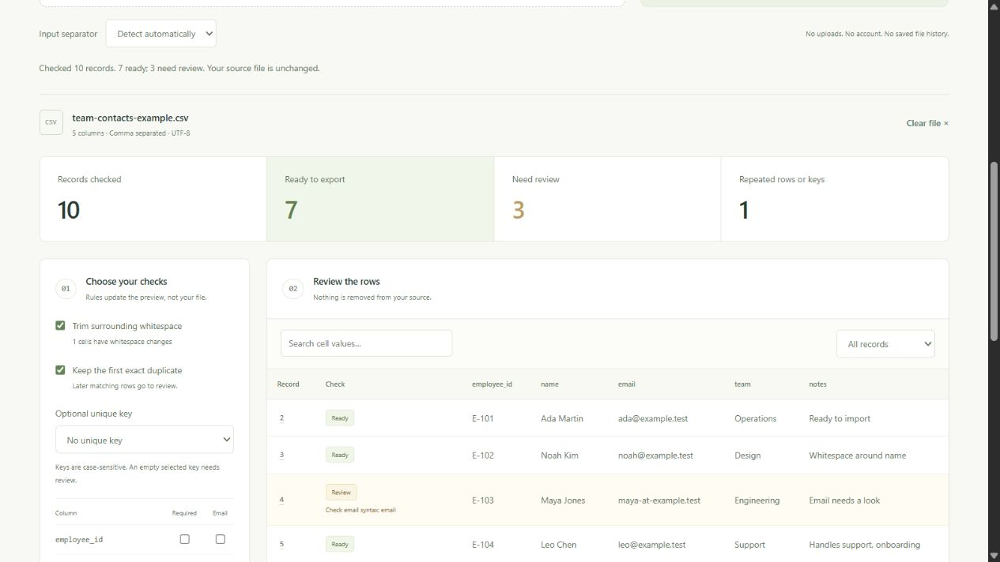

# Rowcraft

**Make your next import a clean one.** A finished browser tool for checking CSV files, reviewing problematic records, and downloading the rows that are ready.

**[Open Rowcraft →](https://ismaeelakin.github.io/rowcraft/)** · [Try the built-in example](https://ismaeelakin.github.io/rowcraft/) · [How it works](docs/DESIGN.md)

[](https://github.com/ismaeelakin/rowcraft/actions/workflows/ci.yml)



## Use your own file

1. Open the app and choose or drop a UTF-8 CSV, or paste CSV text.
2. Review the detected separator. Choose required columns, email checks, an optional unique key, whitespace cleanup and exact-duplicate handling.
3. Inspect the preview, search records, and compare original and processed values.
4. Download the ready rows as CSV. Download a JSON review report for excluded records, original values and reasons.

No account, installation, server upload or paid service is required. The example data lets a reviewer try the entire workflow immediately, then repeat it with their own data.

## Useful, explicit behavior

- Comma, semicolon and tab-separated files; UTF-8 BOM, quoted delimiters, doubled quotes and multiline fields.
- Delimiter detection that respects quoted records, with a manual override for ambiguous files.
- Required fields, practical email syntax checks, optional case-sensitive unique keys and exact duplicate detection.
- Optional surrounding-whitespace cleanup. Original records remain available in detail views and review reports.
- A paginated preview, search, state filters, clear error messages and record-by-record explanations.
- Spreadsheet formula protection on export, including headers. It is enabled by default and can be disabled for raw machine imports.
- Background processing in a Web Worker, with stale-result rejection when files or rules change.

The app **never edits your source file**. Ready-row export is explicit and says how many records are excluded. A rejected earlier record does not reserve a unique key that a later usable record needs.

## Privacy

File contents are processed in memory inside the page and its worker. They are not sent by the app to any server, saved in localStorage, or included in a URL. There are no analytics scripts, third-party fonts or runtime CDN dependencies. A content security policy blocks fetch/XHR connections.

**Clear file** terminates the worker, drops application data references, and clears the preview, details and pasted text. It does not securely erase browser memory, alter downloaded files, or defend against a compromised browser/extension. Loading the site still makes ordinary requests for public site assets; the hosting provider can observe those requests, not your CSV contents through this app.

## Limits and honest edges

| Boundary               | Behavior                                                                                    |
| ---------------------- | ------------------------------------------------------------------------------------------- |
| Input                  | UTF-8 only; up to 3 MiB, 20,000 data records, 50 columns, 100,000 characters per field      |
| Headers                | Nonempty, unique ignoring case, at most 120 characters; trimmed separately from data        |
| Blank physical lines   | Skipped outside quoted fields                                                               |
| Record numbers         | Logical CSV records, with the header as record 1; parsing errors use physical line/column   |
| Ragged records         | Flagged for review, not silently padded or truncated into export                            |
| Email checks           | Basic syntax only; no inbox/domain validation. Empty cells pass unless required             |
| Duplicates / keys      | Case-sensitive, after selected normalization; retain the first usable row                   |
| Exports                | Input separator, UTF-8 without BOM, CRLF record endings, preserved quoted field line breaks |
| Spreadsheet protection | Prefixes formula-like cells with an apostrophe; may also affect negative-number text        |
| Offline                | Works after assets are loaded; there is no installable PWA or persistent offline cache      |

This is a focused CSV workflow, not an Excel reader, general spreadsheet editor, or guarantee that data meets a third-party importer's requirements. Check the receiving system's contract too.

## Run and verify locally

Build/test requires Node.js 22+ and npm. The preview command uses Python 3; any static server can serve `site/` after a build.

```sh
git clone https://github.com/ismaeelakin/rowcraft.git
cd rowcraft
npm ci
npm test
npm run preview
```

Open **http://127.0.0.1:8090**. Use a static server, rather than double-clicking the HTML file, so the module worker can load.

```sh
npm run format:check
npm run check
npm test
```

The 18 tests cover parsing errors, limits, quoting, Unicode, multiline records, delimiter detection, header ambiguity, normalization, required/email/key rules, rejected-first-row behavior, formula-safe exports and report fidelity. A deterministic round-trip test checks **120 generated distributions** across three delimiters against exact original cell values. CI repeats formatting, type checks and tests on Linux and Windows with Node 22 and 24.

## Review the implementation

| Module                       | Responsibility                                                                   |
| ---------------------------- | -------------------------------------------------------------------------------- |
| [csv.ts](src/csv.ts)         | Bounded state-machine parser, header validation and delimiter detection          |
| [quality.ts](src/quality.ts) | Pure normalization and row-checking rules                                        |
| [export.ts](src/export.ts)   | CSV escaping, formula protection and loss-aware review reports                   |
| [worker.ts](src/worker.ts)   | Background parsing and analysis protocol                                         |
| [app.ts](src/app.ts)         | File/paste/drop input, rule state, accessible controls, pagination and downloads |

The product demonstrates practical frontend work: typed data flow, asynchronous state, validation, file APIs, DOM rendering without payload HTML, predictable exports, tests, responsive layout and deployment. [Design notes](docs/DESIGN.md) explain the decisions and the browser verification checklist.

## Deployment

The public site is served from the `gh-pages` branch. `main` contains TypeScript source, tests and the static shell. After a verified build, compiled `site/` assets are published to `gh-pages` with `.nojekyll`. No file data is stored in the repository or deployment branch.
